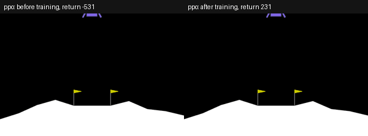
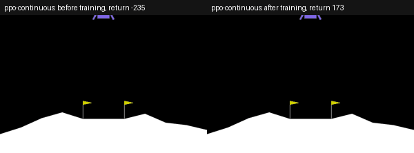
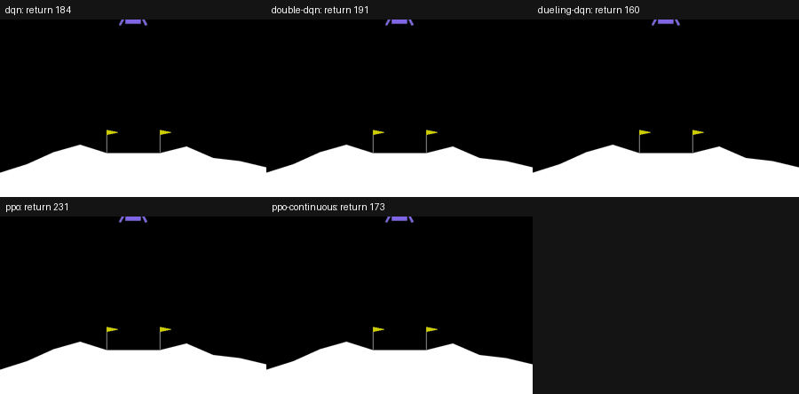
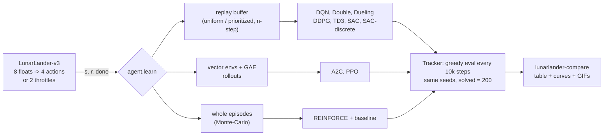
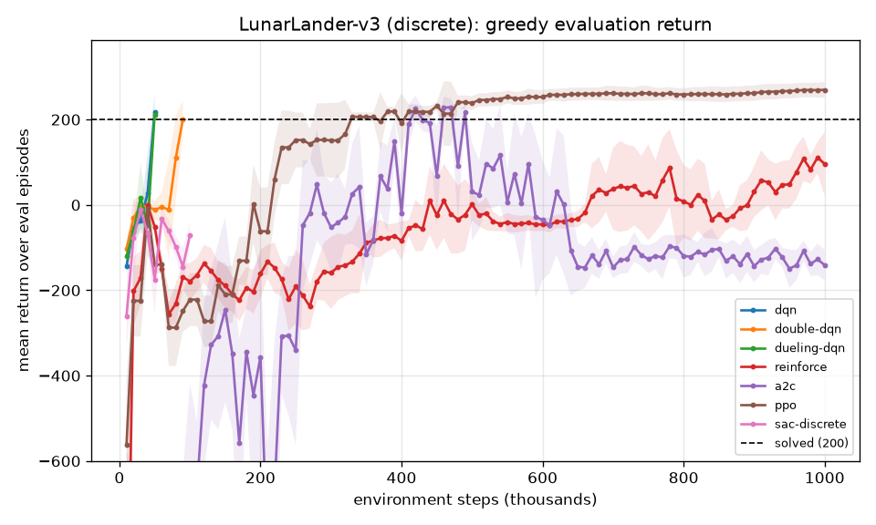
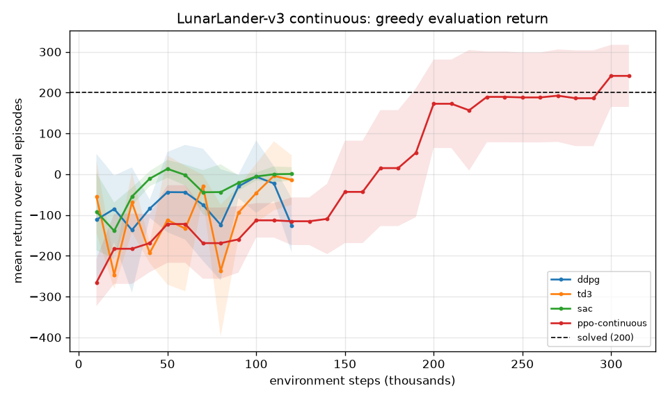
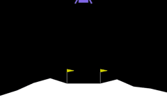

# lunarlander-rl

**LunarLander solved with every classic deep-RL method, in one small PyTorch code base where
each algorithm is one readable file: DQN, Double DQN, Dueling DQN with prioritized replay and
n-step returns, REINFORCE with a baseline, A2C, PPO (vectorised envs, GAE, clipping) and
discrete SAC on the discrete lander, and DDPG, TD3, SAC and Gaussian PPO on the continuous one.
Every method uses the same environment, networks, seeds, evaluation, curves and comparison
table, trains on a CPU in minutes, and comes with tests, runnable examples and a Kaggle/Colab
notebook that explains each update rule next to its code.**

[](LICENSE)
[](pyproject.toml)
[](https://pytorch.org)
[](https://gymnasium.farama.org/environments/box2d/lunar_lander/)
[](docs/testing.md)

## Before and after training

Same episode seed, same network architecture: on the left the network before training (random
weights), on the right the checkpoint from the local CPU run in [Results](#results-short-cpu-runs-not-benchmarks).
The caption above each panel shows that episode's return (200 or more counts as solved).

**PPO, discrete lander** (4 engine buttons)



**PPO, continuous lander** (2 throttles). This seed's landing scores 173, below the 200 bar:
the run's 20-episode mean is 262.5 +- 35.9, so some episodes land less cleanly.



**Every method that solved it locally.** One panel per method that reached a greedy evaluation
of 200 or more and kept a final 20-episode score of at least 150 (A2C reached 200 but then fell
to -145, so it is left out). All panels play the same episode seed, and the caption is that
episode's return.



Regenerate these GIFs from the saved checkpoints with `python scripts/make_gifs.py`; a missing
checkpoint is trained first with its preset.

The point is to understand how each method works by running it: every algorithm is 60-120
lines with its update rule written as equations in the docstring, the networks are small MLPs
(the observation is 8 floats), and one `Config` dataclass describes any run. Change one flag,
retrain, and compare on the same curves.



| method | `--method` | env | how it works, in one line | code |
|---|---|---|---|---|
| DQN | `dqn` | discrete | regress Q(s,a) on r + g max Q_target(s'), replay buffer, target net, epsilon-greedy | [`algorithms/dqn.py`](src/lunarlander_rl/algorithms/dqn.py) |
| Double DQN | `double-dqn` | discrete | online net picks a', target net scores it: less overestimation | `dqn.py` (`double=True`) |
| Dueling DQN + PER + n-step | `dueling-dqn` | discrete | Q = V + A - mean A, replay by TD error with importance weights, 3-step returns | `dqn.py`, [`buffers.py`](src/lunarlander_rl/buffers.py), [`networks.py`](src/lunarlander_rl/networks.py) |
| REINFORCE | `reinforce` | discrete | push up log pi(a\|s) by (return-to-go - V(s)), whole episodes | [`algorithms/reinforce.py`](src/lunarlander_rl/algorithms/reinforce.py) |
| A2C | `a2c` | discrete | same loss, GAE advantages from 16-step rollouts of 8 envs, one step per rollout | [`algorithms/a2c.py`](src/lunarlander_rl/algorithms/a2c.py) |
| PPO | `ppo` | discrete | clipped ratio objective, 4 epochs of minibatches per 16x1024 rollout | [`algorithms/ppo.py`](src/lunarlander_rl/algorithms/ppo.py) |
| discrete SAC | `sac-discrete` | discrete | entropy-regularised actor-critic, exact sums over the 4 actions, learned temperature | [`algorithms/sac_discrete.py`](src/lunarlander_rl/algorithms/sac_discrete.py) |
| DDPG | `ddpg` | continuous | deterministic actor climbs the critic's gradient dQ/da, Gaussian noise | [`algorithms/ddpg.py`](src/lunarlander_rl/algorithms/ddpg.py) |
| TD3 | `td3` | continuous | DDPG + twin critics (min), target smoothing, delayed actor | [`algorithms/td3.py`](src/lunarlander_rl/algorithms/td3.py) |
| SAC | `sac` | continuous | tanh-Gaussian actor, twin critics, reward + alpha * entropy, alpha learned | [`algorithms/sac.py`](src/lunarlander_rl/algorithms/sac.py) |
| PPO (continuous) | `ppo-continuous` | continuous | the PPO code with a diagonal Gaussian policy | `ppo.py` |

Each method's update rule, why each trick is there, and the shapes are in
[docs/architecture.md](docs/architecture.md); the environment and its reward shaping in
[docs/environment.md](docs/environment.md).

## Quick start

```bash
git clone https://github.com/benisalla/lunarlander-rl && cd lunarlander-rl
uv venv .venv && VIRTUAL_ENV=.venv uv pip install -e ".[dev]"     # or: pip install -e ".[dev]"
source .venv/bin/activate

lunarlander-train --list                                 # the 11 methods and their budgets
lunarlander-train --method dqn --stop-when-solved        # -> runs/dqn (config, weights, metrics)
lunarlander-eval runs/dqn --episodes 100                 # greedy policy, fixed unseen seeds
lunarlander-play runs/dqn --gif assets/dqn.gif           # watch it land
lunarlander-compare runs --out assets                    # table + curves for every run
```

`gymnasium[box2d]` installs Box2D from a prebuilt wheel, so no `swig` or compiler is needed.
With `uv`, torch comes from the CPU-only wheel index (set in `pyproject.toml`); plain `pip`
uses the default torch. Any hyperparameter can be changed with `--set key=value`
(`--set double=true --set n_step=3`, `--set hidden=64,64`); see [docs/training.md](docs/training.md).

## Examples

[`examples/`](examples/README.md) holds six numbered scripts that use the package from Python,
in order, each one command on a CPU: explore the env and verify its reward shaping, train a DQN
variant, train a policy-gradient method, train on the continuous env, compare several methods
with one budget, and watch / record a saved agent.

```bash
python examples/01_explore_the_env.py && python examples/02_train_dqn.py --method double-dqn
python examples/04_train_continuous.py --method td3
```

## Results (short CPU runs, not benchmarks)

Every method was trained once (seed 0) with its preset from `lunarlander-train --list`, on **one
CPU thread** of a shared 8-core machine, with `scripts/run_all.py`. The replay methods and PPO
used `--stop-when-solved` (training ends at the first periodic greedy evaluation of 10 episodes
with mean >= 200); the final PPO, REINFORCE and A2C runs used their full 1M-step budget. Every run
had a wall-clock cap of 5-13 minutes. The final score is a fresh greedy evaluation on 20 unseen
episodes. Total training time for all runs below: about 67 minutes. These numbers show that each
method learns and roughly how fast; one seed is not a ranking.

| method | env | steps to solve | final return (20 ep) | best eval | steps run | wall time |
|---|---|---|---|---|---|---|
| `dqn` | discrete | **50,000** | **209.3 +- 69.5** | 217.8 | 50,000 | 2.3 min |
| `double-dqn` | discrete | **90,000** | **227.6 +- 29.3** | 200.9 | 90,000 | 4.4 min |
| `dueling-dqn` | discrete | **50,000** | 167.1 +- 99.7 | 212.0 | 50,000 | 1.5 min |
| `reinforce` | discrete | not reached | 45.7 +- 102.3 | 111.2 | 1,000,063 | 8.8 min |
| `a2c` | discrete | **420,000** | -144.6 +- 32.4 | 228.9 | 1,000,064 | 4.9 min |
| `ppo` | discrete | **330,000** | **276.4 +- 18.2** | 269.6 | 1,015,808 | 6.2 min |
| `sac-discrete` | discrete | not reached | -53.8 +- 39.1 | -11.7 | 100,000 | 6.1 min |
| `ddpg` | continuous | not reached | -60.5 +- 121.3 | -6.0 | 120,000 | 5.1 min |
| `td3` | continuous | not reached | 3.0 +- 38.4 | -4.0 | 120,000 | 4.6 min |
| `sac` | continuous | not reached | 8.9 +- 21.3 | 13.1 | 120,000 | 9.8 min |
| `ppo-continuous` | continuous | **300,000** | **262.5 +- 35.9** | 241.0 | 311,296 | 1.5 min |

Reference policies on the same evaluation (20 episodes, `lunarlander-eval --baseline ...`):
random actions **-142.7 +- 80.1**; gymnasium's hand-written PID controller **265.9 +- 35.4** on
the discrete lander and **288.2 +- 16.9** on the continuous one.




What the runs show:

* **The DQN family is the most sample-efficient on the discrete lander**: DQN and dueling DQN
  (+ PER + 3-step) reach a 200+ evaluation at 50k steps in 1.5-2.3 minutes, Double DQN at 90k
  with the steadiest final score (227.6 +- 29.3). Dueling DQN's final 20-episode score (167) is
  lower than its stopping evaluation (212): stopping at the first lucky evaluation of 10 episodes
  is optimistic, which is why the final column uses fresh episodes.
* **PPO is the most reliable**: it needs ~330k steps (cheap on vector envs: 6 minutes for a
  million) but then stays above 250 for the rest of the run and ends at **276.4 +- 18.2**, the best
  score here. The same code with a Gaussian policy solves the continuous lander in 300k steps
  and 1.5 minutes (**262.5 +- 35.9**).
* **A2C touches 200 (at 420k) and then collapses** to about -140: one gradient step per tiny
  rollout and no trust region make it unstable on this task. **REINFORCE** improves slowly and
  noisily (+46 after 1M steps): Monte-Carlo returns over up to 1000 steps are a high-variance signal.
* **Discrete SAC, DDPG, TD3 and SAC did not reach 200 in these budgets** (100-120k steps, one
  gradient step every 2 env steps on 128x128 nets, to fit one CPU thread). They are learning
  (from about -250 to about 0: the lander hovers and descends but does not yet commit to landing),
  and these methods are known to need ~200-500k steps with one update per step and 256x256 nets
  on LunarLanderContinuous. The notebook runs them with those settings.

Per-run training curves (exploration included) are in `assets/train_<method>.png`. Greedy
landings recorded with `lunarlander-play` (episode seed 3):

| PPO (discrete) | PPO (continuous) | DQN | TD3 (not solved: hovers) |
|---|---|---|---|
|  |  |  |  |

Rebuild the table, curves and GIFs from `runs/` with `python scripts/make_assets.py`.

## Repository layout

```
src/lunarlander_rl/
  config.py        Config dataclass (every hyperparameter) + METHODS presets
  envs.py          LunarLander (discrete / continuous), vector envs, seeds, shaping potential, heuristic
  networks.py      MLPs: Q, dueling Q, categorical / Gaussian / tanh-Gaussian / deterministic actors, critics
  buffers.py       replay buffer with n-step returns, prioritized replay (sum tree)
  algorithms/      one file per method: dqn, reinforce, a2c, ppo (+ rollout.py: GAE),
                   ddpg, td3, sac, sac_discrete (+ offpolicy.py: the shared replay loop)
  metrics.py       Tracker: step counter, periodic greedy evaluation, episode log, summary
  evaluate.py      the one evaluation protocol + random / heuristic baselines   (lunarlander-eval)
  train.py         train(cfg), load_agent(run_dir)                              (lunarlander-train)
  play.py          episodes and GIFs                                            (lunarlander-play)
  compare.py       results table + curves from runs/*/metrics.json              (lunarlander-compare)
  viz.py           plots
tests/             49 pytest tests (about 30 s): buffers, GAE, log-probs, every agent learns a bandit
examples/          01-06 runnable scripts (see examples/README.md)
docs/              architecture.md, environment.md, training.md, evaluation.md, testing.md, data.md
notebooks/         build_notebook.py -> train_colab_kaggle.ipynb
scripts/           run_all.py (train several methods), make_assets.py (table, curves),
                   make_gifs.py (before/after and solved-grid GIFs)
assets/            figures, GIFs and results.md from the local runs
```

## Documentation

* [docs/architecture.md](docs/architecture.md): every algorithm, its update rule and why each piece is there
* [docs/environment.md](docs/environment.md): observation, actions, reward shaping, truncation vs termination
* [docs/training.md](docs/training.md): CLI, presets and their reasons, where the CPU time goes, tuning tips
* [docs/evaluation.md](docs/evaluation.md): the shared evaluation protocol and the table columns
* [docs/testing.md](docs/testing.md): what the tests check and why a bandit for the learning tests

## Notebook

[`notebooks/train_colab_kaggle.ipynb`](notebooks/train_colab_kaggle.ipynb) (generated by
`python notebooks/build_notebook.py`) installs the package from GitHub, explains the env and the
reward shaping, prints each algorithm's update rule from the package source with a plain-words
explanation, then trains all 11 methods with bigger budgets (256x256 nets, one update per step,
300k-2M steps, several seeds if you want) and builds the same table and figures.

## Legacy notebooks

None: this repository was written new, there is no earlier notebook for LunarLander. The
owner's CartPole policy-gradient coursework lives in the `cartpole-rl` repository.

## License

MIT, see [LICENSE](LICENSE).
