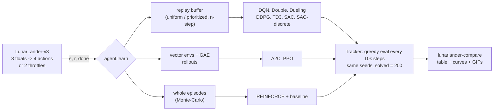

# lunarlander-rl

**LunarLander solved with every classic deep-RL method, in one small PyTorch code base where
each algorithm is one readable file: DQN, Double DQN, Dueling DQN with prioritized replay and
n-step returns, REINFORCE with a baseline, A2C, PPO (vectorised envs, GAE, clipping) and
discrete SAC on the discrete lander, and DDPG, TD3, SAC and Gaussian PPO on the continuous one.
Every method uses the same environment, networks, seeds, evaluation, curves and comparison
table, trains on a CPU in minutes, and comes with tests, runnable examples and a Kaggle/Colab
notebook that explains each update rule next to its code.**

[](LICENSE)
[](pyproject.toml)
[](https://pytorch.org)
[](https://gymnasium.farama.org/environments/box2d/lunar_lander/)
[](docs/testing.md)

The point is to understand how each method works by running it: every algorithm is 60-120
lines with its update rule written as equations in the docstring, the networks are small MLPs
(the observation is 8 floats), and one `Config` dataclass describes any run. Change one flag,
retrain, and compare on the same curves.



| method | `--method` | env | how it works, in one line | code |
|---|---|---|---|---|
| DQN | `dqn` | discrete | regress Q(s,a) on r + g max Q_target(s'), replay buffer, target net, epsilon-greedy | [`algorithms/dqn.py`](src/lunarlander_rl/algorithms/dqn.py) |
| Double DQN | `double-dqn` | discrete | online net picks a', target net scores it: less overestimation | `dqn.py` (`double=True`) |
| Dueling DQN + PER + n-step | `dueling-dqn` | discrete | Q = V + A - mean A, replay by TD error with importance weights, 3-step returns | `dqn.py`, [`buffers.py`](src/lunarlander_rl/buffers.py), [`networks.py`](src/lunarlander_rl/networks.py) |
| REINFORCE | `reinforce` | discrete | push up log pi(a\|s) by (return-to-go - V(s)), whole episodes | [`algorithms/reinforce.py`](src/lunarlander_rl/algorithms/reinforce.py) |
| A2C | `a2c` | discrete | same loss, GAE advantages from 16-step rollouts of 8 envs, one step per rollout | [`algorithms/a2c.py`](src/lunarlander_rl/algorithms/a2c.py) |
| PPO | `ppo` | discrete | clipped ratio objective, 4 epochs of minibatches per 16x1024 rollout | [`algorithms/ppo.py`](src/lunarlander_rl/algorithms/ppo.py) |
| discrete SAC | `sac-discrete` | discrete | entropy-regularised actor-critic, exact sums over the 4 actions, learned temperature | [`algorithms/sac_discrete.py`](src/lunarlander_rl/algorithms/sac_discrete.py) |
| DDPG | `ddpg` | continuous | deterministic actor climbs the critic's gradient dQ/da, Gaussian noise | [`algorithms/ddpg.py`](src/lunarlander_rl/algorithms/ddpg.py) |
| TD3 | `td3` | continuous | DDPG + twin critics (min), target smoothing, delayed actor | [`algorithms/td3.py`](src/lunarlander_rl/algorithms/td3.py) |
| SAC | `sac` | continuous | tanh-Gaussian actor, twin critics, reward + alpha * entropy, alpha learned | [`algorithms/sac.py`](src/lunarlander_rl/algorithms/sac.py) |
| PPO (continuous) | `ppo-continuous` | continuous | the PPO code with a diagonal Gaussian policy | `ppo.py` |

Each method's update rule, why each trick is there, and the shapes are in
[docs/architecture.md](docs/architecture.md); the environment and its reward shaping in
[docs/environment.md](docs/environment.md).

## Quick start

```bash
git clone https://github.com/benisalla/lunarlander-rl && cd lunarlander-rl
uv venv .venv && VIRTUAL_ENV=.venv uv pip install -e ".[dev]"     # or: pip install -e ".[dev]"
source .venv/bin/activate

lunarlander-train --list                                 # the 11 methods and their budgets
lunarlander-train --method dqn --stop-when-solved        # -> runs/dqn (config, weights, metrics)
lunarlander-eval runs/dqn --episodes 100                 # greedy policy, fixed unseen seeds
lunarlander-play runs/dqn --gif assets/dqn.gif           # watch it land
lunarlander-compare runs --out assets                    # table + curves for every run
```

`gymnasium[box2d]` installs Box2D from a prebuilt wheel, so no `swig` or compiler is needed.
With `uv`, torch comes from the CPU-only wheel index (set in `pyproject.toml`); plain `pip`
uses the default torch. Any hyperparameter can be changed with `--set key=value`
(`--set double=true --set n_step=3`, `--set hidden=64,64`); see [docs/training.md](docs/training.md).

## Examples

[`examples/`](examples/README.md) holds six numbered scripts that use the package from Python,
in order, each one command on a CPU: explore the env and verify its reward shaping, train a DQN
variant, train a policy-gradient method, train on the continuous env, compare several methods
with one budget, and watch / record a saved agent.

```bash
python examples/01_explore_the_env.py && python examples/02_train_dqn.py --method double-dqn
python examples/04_train_continuous.py --method td3
```

RESULTS_PLACEHOLDER

## Repository layout

```
src/lunarlander_rl/
  config.py        Config dataclass (every hyperparameter) + METHODS presets
  envs.py          LunarLander (discrete / continuous), vector envs, seeds, shaping potential, heuristic
  networks.py      MLPs: Q, dueling Q, categorical / Gaussian / tanh-Gaussian / deterministic actors, critics
  buffers.py       replay buffer with n-step returns, prioritized replay (sum tree)
  algorithms/      one file per method: dqn, reinforce, a2c, ppo (+ rollout.py: GAE),
                   ddpg, td3, sac, sac_discrete (+ offpolicy.py: the shared replay loop)
  metrics.py       Tracker: step counter, periodic greedy evaluation, episode log, summary
  evaluate.py      the one evaluation protocol + random / heuristic baselines   (lunarlander-eval)
  train.py         train(cfg), load_agent(run_dir)                              (lunarlander-train)
  play.py          episodes and GIFs                                            (lunarlander-play)
  compare.py       results table + curves from runs/*/metrics.json              (lunarlander-compare)
  viz.py           plots
tests/             47 pytest tests (about 1 minute): buffers, GAE, log-probs, every agent learns a bandit
examples/          01-06 runnable scripts (see examples/README.md)
docs/              architecture.md, environment.md, training.md, evaluation.md, testing.md, data.md
notebooks/         build_notebook.py -> train_colab_kaggle.ipynb
scripts/           run_all.py: train several methods in one process
assets/            figures, GIFs and results.md from the local runs
```

## Documentation

* [docs/architecture.md](docs/architecture.md): every algorithm, its update rule and why each piece is there
* [docs/environment.md](docs/environment.md): observation, actions, reward shaping, truncation vs termination
* [docs/training.md](docs/training.md): CLI, presets and their reasons, where the CPU time goes, tuning tips
* [docs/evaluation.md](docs/evaluation.md): the shared evaluation protocol and the table columns
* [docs/testing.md](docs/testing.md): what the tests check and why a bandit for the learning tests

## Notebook

[`notebooks/train_colab_kaggle.ipynb`](notebooks/train_colab_kaggle.ipynb) (generated by
`python notebooks/build_notebook.py`) installs the package from GitHub, explains the env and the
reward shaping, prints each algorithm's update rule from the package source with a plain-words
explanation, then trains all 11 methods with bigger budgets (256x256 nets, one update per step,
300k-2M steps, several seeds if you want) and builds the same table and figures.

## Legacy notebooks

None: this repository was written new, there is no earlier notebook for LunarLander. The
owner's CartPole policy-gradient coursework lives in the `cartpole-rl` repository.

## License

MIT, see [LICENSE](LICENSE).
